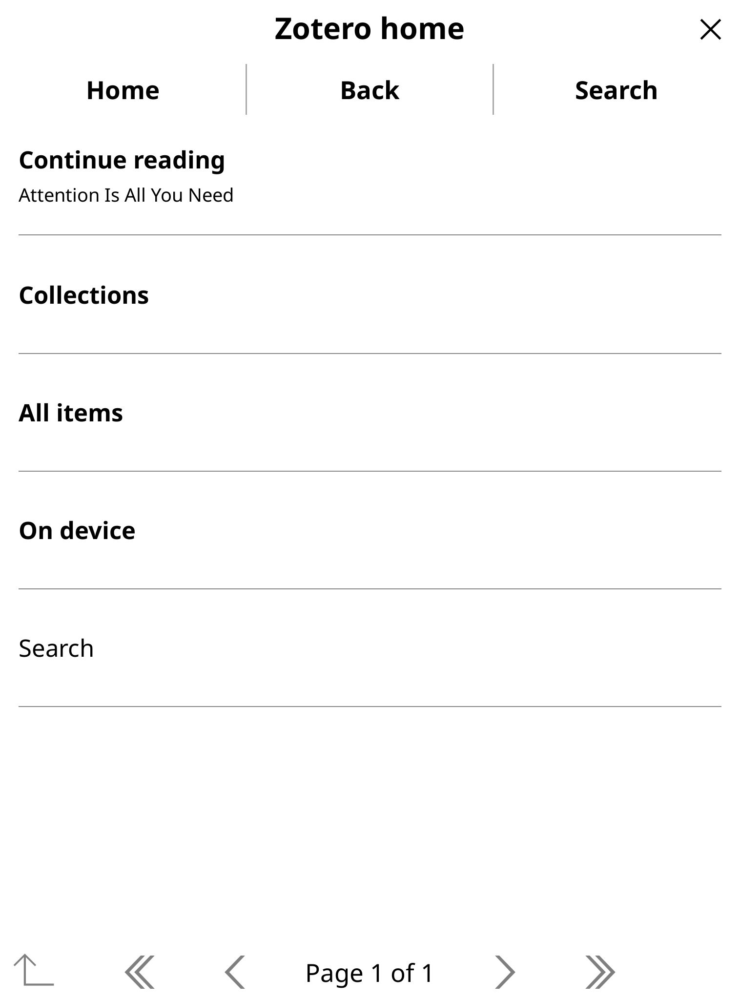
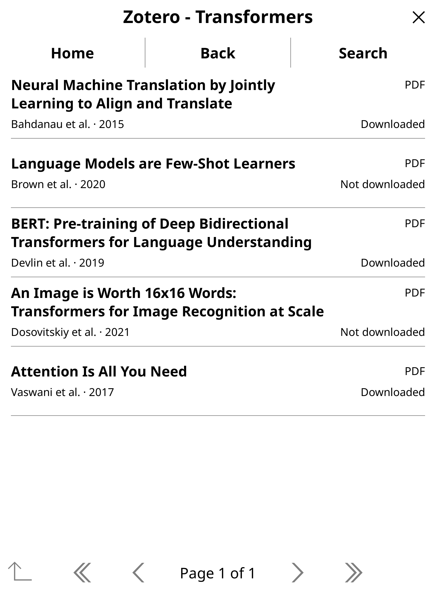
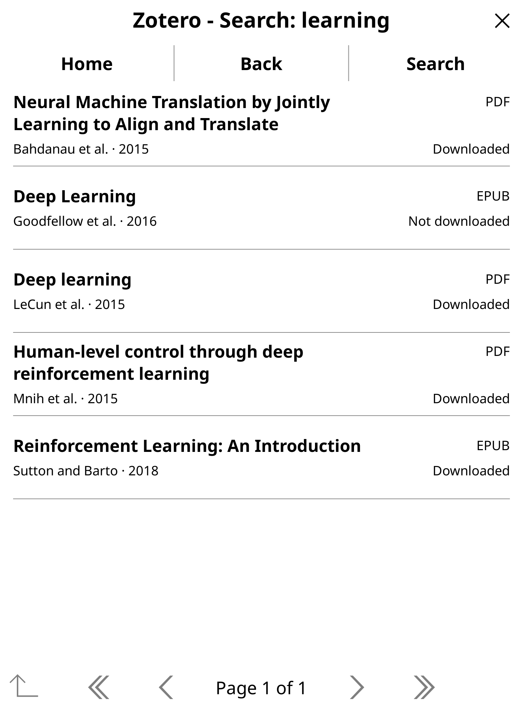
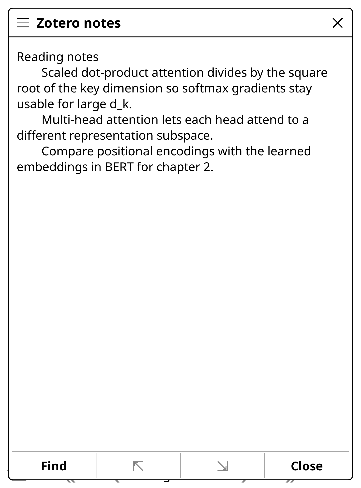

# Zotero for KOReader

Browse your Zotero library, download and read PDFs and EPUBs, and sync highlights
and reading positions with Zotero.

[Install](#install) | [Features](#features) | [Configuration](#configuration) | [Compatibility](#compatibility-and-requirements) | [Help](#help) | [Contributing](#contributing)

 

&nbsp;
&nbsp;
&nbsp;

## Features

| Feature | Description |
| --- | --- |
| Browse your library | Collections, subcollections, All items and personal or group libraries |
| Search | Titles, first authors and DOIs, with an optional tag filter |
| Download on demand | One tap per paper, or a whole collection at once. Zotero storage or WebDAV |
| Read offline | Downloaded files open without Wi-Fi or credentials. *On device* lists them |
| Continue reading | Jump back into the last document, and return to where you were in the library |
| Zotero notes | Read a paper's notes from the last sync, offline |
| Highlight sync | Two-way PDF and EPUB highlights, with offline edits and conflict review *(opt-in)* |
| Reading position | Pick up on Zotero desktop at the page you left on your e-reader *(opt-in)* |
| Background sync | Never blocks reading. Optional sync on startup or when the cache is a day old |
| Sorting | Alphabetical, or by date added |

Metadata sync is read-only. The plugin writes to Zotero only when you turn on highlight or reading-position sync.

## Install

1. Download `zotero.koplugin.zip` from the [latest release](https://github.com/firilisinof/zotero.koplugin/releases/latest), or build it with `make package`.
2. Extract it into `<KOReader>/plugins/` and restart KOReader.
3. Create an API key in your [Zotero settings](https://www.zotero.org/settings/keys) and note your user ID.
4. Open **Zotero** from the search tab (magnifying glass) of the top menu, then **Settings > Configure Zotero account**.

When updating, replace the plugin folder. Your downloads, reading progress and settings live in `<KOReader>/zotero` and stay put.

## Configuration

Everything is under **Zotero > Settings**.

| Setting | What it does |
| --- | --- |
| Configure Zotero account | Personal library (user ID) or group library (group ID), plus API key |
| Enable WebDAV storage | Download attachments from your own WebDAV server, e.g. [Nextcloud](https://nextcloud.com). Personal libraries only |
| Filter by tag | Show only items with one exact tag |
| Sort items | Alphabetical, newest first or oldest first |
| Sync on startup / on browse | Automatic sync when already online. Off by default |
| Sync highlights | Two-way annotation sync. Needs write access. |
| Share reading position | Shares the PDF page or EPUB location with Zotero |

Hold a collection to download its direct attachments, or hold a paper to read its notes.

## Compatibility and requirements

Use an API key with [permissions for the features you need](docs/faq.md#what-permissions-does-my-api-key-need).
Attachments must be available through Zotero storage or, for personal libraries,
WebDAV. Linked files can only be opened from an existing local copy.

Tested software: KOReader desktop emulator `v2026.07.2-130-g92bf75f03` and
Zotero desktop **10.0.1**.

## Help

- [Library, downloads and settings FAQ](docs/faq.md)
- [Reading-position sharing](docs/position-sharing.md)
- [Highlight sync](docs/highlight-sync.md)

## Contributing

See [CONTRIBUTING.md](CONTRIBUTING.md) for development setup and tests.
LLM contributors should also read [AGENTS.md](AGENTS.md).

## Credits

Forked from [stelzch/zotero.koplugin](https://github.com/stelzch/zotero.koplugin). Licensed under the [GPL-3.0](LICENSE). Bug reports and pull requests are welcome.
