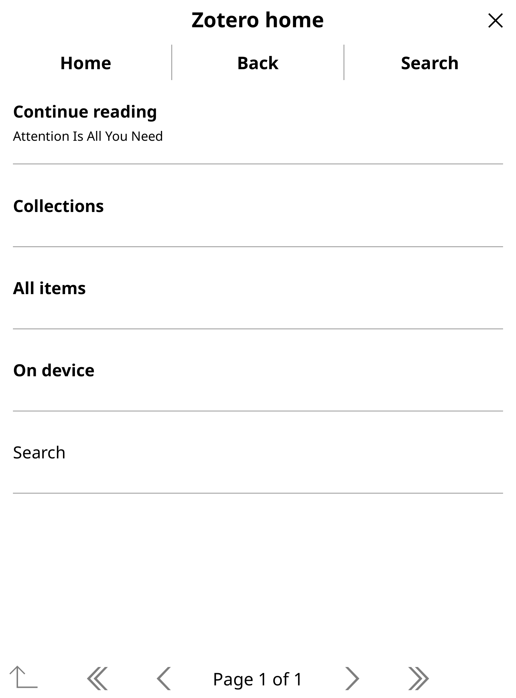
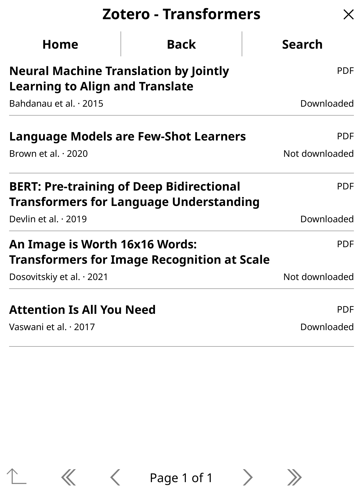
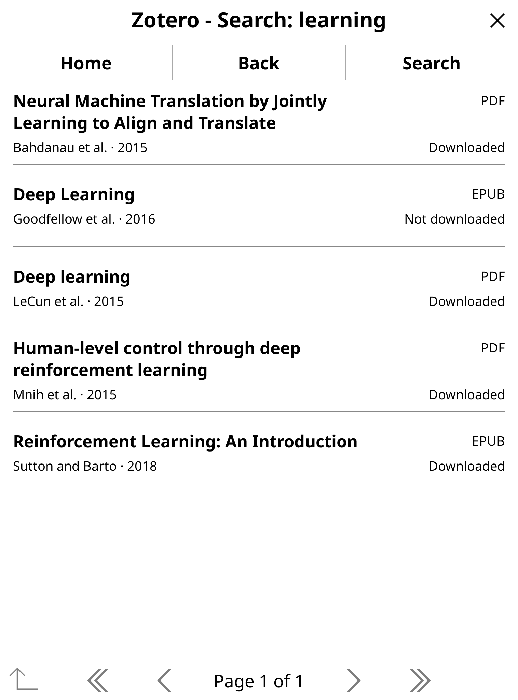
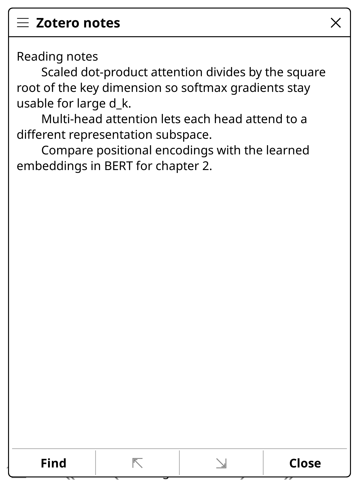

<div align="center">

# Zotero for KOReader

**Your Zotero library on your e-reader.** Browse collections, search, download and read PDFs and EPUBs, then sync your highlights and reading position back to Zotero.

[Install](#install) | [Features](#features) | [Configuration](#configuration) | [Development](#development)

<br>

&nbsp;
&nbsp;
&nbsp;


</div>

## Features

| Feature | Description |
| --- | --- |
| **Browse your library** | Collections, subcollections, All items and personal or group libraries |
| **Search** | Titles, first authors and DOIs, with an optional tag filter |
| **Download on demand** | One tap per paper, or a whole collection at once. Zotero storage or WebDAV |
| **Read offline** | Downloaded files open without Wi-Fi or credentials. *On device* lists them |
| **Continue reading** | Jump back into the last document, and return to where you were in the library |
| **Zotero notes** | Read a paper's notes from the last sync, offline |
| **Highlight sync** | Two-way PDF and EPUB highlights, with offline edits and conflict review *(opt-in)* |
| **Reading position** | Pick up on Zotero desktop at the page you left on your e-reader *(opt-in)* |
| **Background sync** | Never blocks reading. Optional sync on startup or when the cache is a day old |
| **Sorting** | Alphabetical, or by date added |

Metadata sync is read-only. The plugin writes to Zotero only when you turn on highlight or reading-position sync.

## Install

1. Download `zotero.koplugin.zip` from the [latest release](https://github.com/firilisinof/zotero.koplugin/releases/latest), or build it with `make package`.
2. Extract it into `<KOReader>/plugins/` and restart KOReader.
3. Create an API key in your [Zotero settings](https://www.zotero.org/settings/keys) and note your user ID.
4. Open **Zotero** from the search tab (magnifying glass) of the top menu, then **Settings → Configure Zotero account**.

When updating, replace the plugin folder. Your downloads, reading progress and settings live in `<KOReader>/zotero` and stay put.

## Configuration

Everything is under **Zotero → Settings**.

| Setting | What it does |
| --- | --- |
| Configure Zotero account | Personal library (user ID) or group library (group ID), plus API key |
| Enable WebDAV storage | Download attachments from your own WebDAV server, e.g. [Nextcloud](https://nextcloud.com). Personal libraries only |
| Filter by tag | Show only items with one exact tag |
| Sort items | Alphabetical, newest first or oldest first |
| Sync on startup / on browse | Automatic sync when already online. Off by default |
| Sync highlights | Two-way annotation sync. Needs write access. |
| Share reading position | Shares the PDF page or EPUB location with Zotero |

**Tips:** hold a collection to download all of it, and hold a paper to read its notes.

<details>
<summary>Configure without typing on the e-reader</summary>

Edit `<KOReader>/zotero/meta.lua`:

```lua
return {
    ["api_key"] = "",
    ["library_type"] = "user",  -- "user" or "group"
    ["user_id"] = "",
    ["group_id"] = "",          -- only for group libraries
    ["webdav_enabled"] = false,
    ["webdav_url"] = "",        -- as entered in Zotero; "/zotero" is added when missing
    ["webdav_user"] = "",
    ["webdav_password"] = "",   -- an app password is safer
}
```

</details>

## Development

```sh
make setup   # one time: clone and build KOReader for the desktop emulator
make run     # open the emulator with the plugin loaded
make test    # offline integration suite
make check   # unit tests, syntax and package checks (what CI runs)
```

See [CLAUDE.md](CLAUDE.md) for architecture and test conventions.

## Credits

Forked from [stelzch/zotero.koplugin](https://github.com/stelzch/zotero.koplugin). Licensed under the [GPL-3.0](LICENSE). Bug reports and pull requests are welcome.
